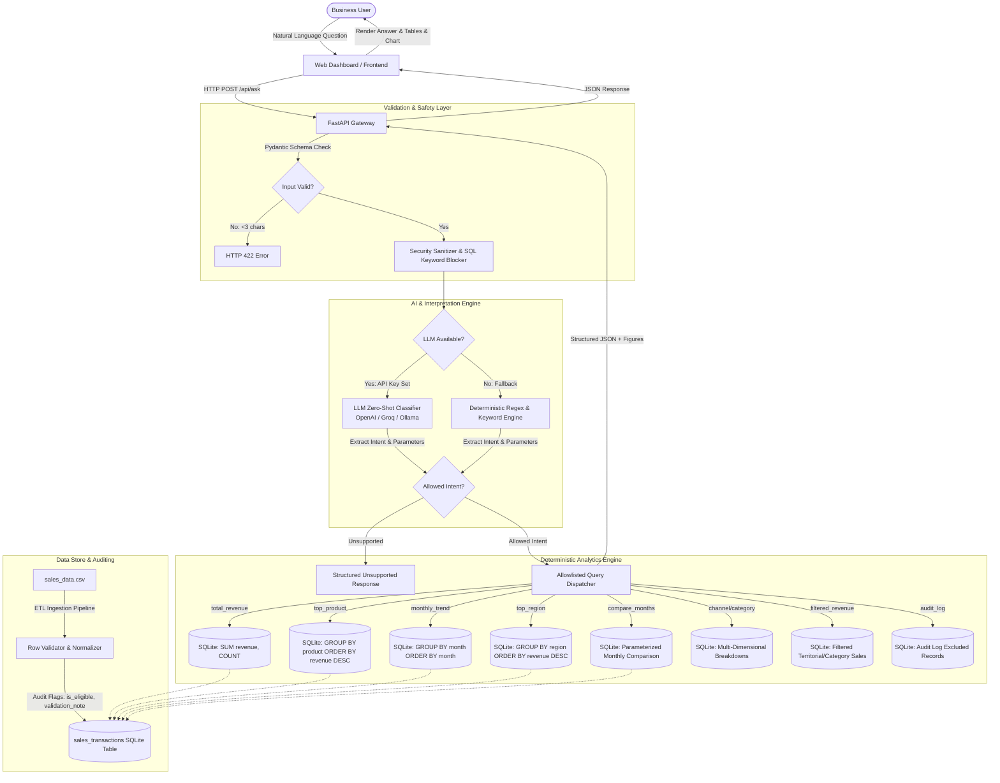
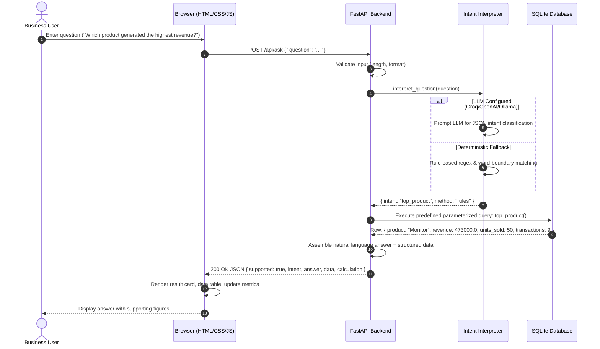

# System Architecture & Technical Design

## 1. High-Level Architecture Overview

The **RSG Mini AI Business Intelligence Assistant** is designed around a **Vectorless RAG (Retrieval-Augmented Generation)** / **Schema-Grounded Tool Execution** pattern. 

Unlike naive Text-to-SQL systems that allow an LLM to generate unrestricted SQL strings directly, this system uses AI strictly to **classify intent** and **extract typed parameters**, then delegates execution to **allowlisted, parameterized, deterministic database queries**.

---

## 2. Request/Response Sequence

---

## 3. Database Schema & Data Cleansing

### Schema: `sales_transactions`

| Column | Type | Description |
| :--- | :--- | :--- |
| `transaction_id` | `TEXT PRIMARY KEY` | Unique transaction identifier (e.g. `TXN0001`) |
| `order_date` | `TEXT` | Normalized ISO date (`YYYY-MM-DD`) indexed for temporal grouping |
| `product` | `TEXT` | Product name (e.g. `Monitor`, `Desk`) |
| `category` | `TEXT` | Product category (`Accessories`, `Furniture`, `Electronics`) |
| `region` | `TEXT` | Geographical sales region (`North`, `South`, `East`, `West`) |
| `sales_channel` | `TEXT` | Sales channel (`Online`, `Retail`) |
| `quantity` | `INTEGER` | Quantity of units sold |
| `unit_price` | `REAL` | Unit selling price |
| `discount_amount` | `REAL` | Discount granted on transaction |
| `status` | `TEXT` | Transaction status (`Completed`, `Returned`, etc.) |
| `revenue` | `REAL` | Net calculated revenue (`quantity * unit_price - discount_amount`) |
| `is_eligible` | `INTEGER` | `1` if completed and valid; `0` if excluded |
| `validation_note` | `TEXT` | Human-readable explanation if excluded from revenue |

### Indexes
- `idx_sales_date ON sales_transactions(order_date)`
- `idx_sales_product ON sales_transactions(product)`
- `idx_sales_region ON sales_transactions(region)`

---

## 4. Revenue Calculation Policy & Data Quality

In real-world business intelligence, data must not be silently discarded. To ensure full transparency and auditability:
1. **Preserve All Rows:** All 51 records from `sales_data.csv` are imported into the database.
2. **Eligibility Criteria:** A transaction is eligible (`is_eligible = 1`) if and only if:
   - `status == "Completed"` (Returned items are excluded).
   - `quantity > 0` (Zero or negative quantities are invalid).
   - `unit_price >= 0` and is not null.
   - `discount_amount >= 0` and does not exceed gross amount (`quantity * unit_price`).
   - Required descriptive fields (`product`, `region`, `channel`) are non-empty.
3. **Audit Log:**
   - **51 Total rows loaded**
   - **48 Eligible rows**
   - **3 Excluded rows:**
     - `TXN0033`: `non-completed transaction excluded from revenue` (Status = `Returned`)
     - `TXN0034`: `quantity must be greater than zero` (Quantity = `0`)
     - `TXN0051`: `missing or invalid unit price` (Unit_price = `NULL`)
4. **Net Revenue Formula:**
   $$\text{Net Revenue} = (\text{Quantity} \times \text{Unit Price}) - \text{Discount Amount}$$

---

## 5. Why Vectorless RAG over Vector RAG for BI

| Feature | Traditional Vector RAG | Vectorless RAG (Our Architecture) |
| :--- | :--- | :--- |
| **Data Type** | Unstructured text (PDFs, docs) | Structured tabular data (CSV, SQL) |
| **Aggregation (SUM/AVG/MAX)** | ❌ Terrible: cannot accurately aggregate over 1000s of chunks | ✅ Exact: executes SQL `SUM()` / `GROUP BY` deterministically |
| **Hallucination Risk** | High: LLM synthesizes numbers from retrieved text | Zero: Numbers come directly from database engine |
| **Security** | Risk of prompt injection in context window | High: No SQL generation; allowlisted intents only |
| **Latency & Cost** | Requires vector embeddings and large context windows | Sub-millisecond SQL queries, lightweight intent classification |

---

## 6. Query Safety & Text-to-SQL Guardrails

To fulfill the security requirement (*"If using text-to-SQL, validate the generated query before execution. Do not allow destructive database operations."*), the system implements defense-in-depth:
1. **No Dynamic SQL Generation:** User text is never directly interpolated or concatenated into SQL queries.
2. **Intent & Parameter Constancy:** LLM output is strictly mapped to an allowlist of 5 intents. Parameters (such as months) are validated against strict regex (`^20\d{2}-(0[1-9]|1[0-2])$`).
3. **Query Validator (`validate_sql_query`):** A standalone AST-style validator ensures:
   - Queries must begin with `SELECT` or `WITH`.
   - Disallows destructive tokens: `DROP`, `DELETE`, `UPDATE`, `INSERT`, `ALTER`, `TRUNCATE`, `ATTACH`, `CREATE`, `EXEC`.
   - Disallows query chaining via `;`.
4. **Parameter Binding:** All SQL statements use SQLite parameterized placeholders (`?`).

---

## 7. Known Limitations

1. **Preset Analytical Dimensions:** The system is optimized for the five core business questions. Unprecedented multidimensional queries (e.g. *"Show average discount percentage for monitors in West region during weekends"*) are flagged as unsupported rather than guessing.
2. **Single-Table Scope:** The current implementation operates over a single denormalized table `sales_transactions`.
3. **Authentication & Multi-Tenancy:** Designed as an assessment prototype without multi-user auth or row-level permissions.
